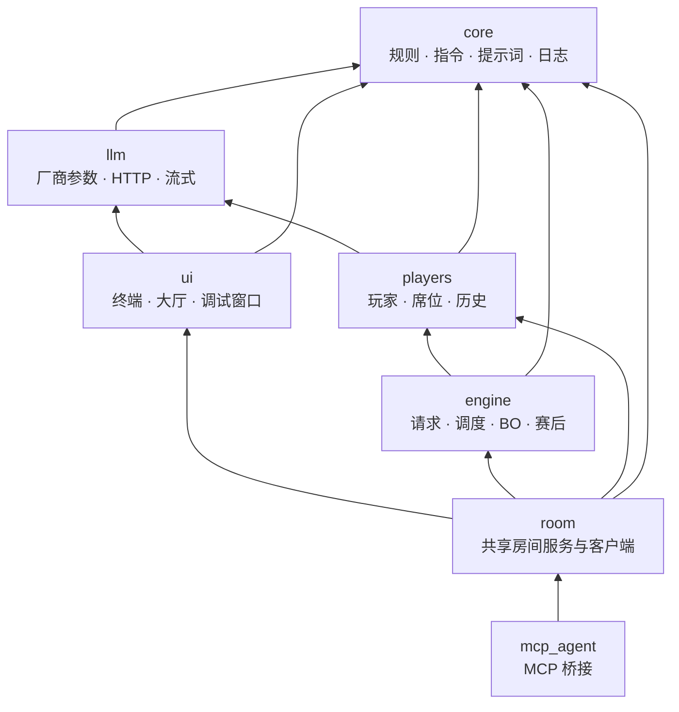

# 架构与目录

适用版本：`codex/mcp-agent` 开发分支。

## 目录

```text
model-rps-protocol/
├─ src/model_rps/        源码（见下文分层）
├─ tests/                unittest / pytest 用例，不调用真实模型
├─ docs/                 本目录
├─ examples/             宿主配置示例（DSH）
├─ validation/           针对真实服务的验证脚本（会请求 API，需自备配置）
├─ experiments/          一次性实验脚本
├─ artifacts/            验证与实验产物（Git 忽略）
├─ logs/                 每场比赛的日志（Git 忽略）
├─ config.example.toml   配置模板；复制为 config.toml 使用
├─ run.ps1               Windows 启动脚本
└─ pyproject.toml        打包、入口与 pytest / ruff 配置
```

## 分层

源码按职责分为七层，依赖只能向下。`cli.py`、`config.py`、`player_factory.py` 和 `__main__.py` 留在包根，负责把各层组装成可运行的程序。



| 层 | 模块 | 职责 |
| --- | --- | --- |
| `core` | `game`、`commands`、`prompts`、`identities`、`diagnostics`、`logs` | 裁判规则、隐藏状态与结算；统一指令语法与阶段校验；最小规则提示词；席位显示名；诊断上下文；每场 BO 的 UTF-8 日志与脱敏。不读取终端、不拼装 HTTP |
| `llm` | `adapters`、`transport`、`streaming`、`anthropic` | 六种厂商的参数映射、鉴权与地址；HTTP 与流式生命周期；Chat Completions SSE 解码；Claude Messages 响应转换。不管理比分与历史 |
| `players` | `base`、`seats`、`history`、`context_usage`、`human`、`external` | 玩家接口、模型玩家与模拟玩家；固定席位及其当前参与者；对话历史与回退；上下文用量记录；人类草稿与交接；外部输入（共享房间与 MCP）的统一玩家接口 |
| `engine` | `requests`、`scheduler`、`runner`、`match`、`postmatch` | 单次交互的超时、校验与重试；每 Tick 的行动权限与收件箱；单局流程；BO 与连续局；赛后公开与聊天 |
| `ui` | `console`、`terminal`、`human_terminal`、`debug_console`、`debug_format`、`lobby` | 前台公共展示；异步人类输入；独立调试窗口及其格式化；比赛之间的大厅 |
| `room` | `base`、`shared`、`service`、`server`、`remote`、`client`、`terminal` | 单场生命周期、席位凭证、事件游标、提交去重；常驻服务与本机 HTTP 玩家接口；人类终端客户端；服务端管理窗口。不实现游戏规则 |
| `mcp_agent` | `server` | stdio MCP 工具，把外部 Agent 接入单场房间（复用 `room.base.Room`）或共享房间（`room.remote`） |

子包名用 `mcp_agent` 而不是 `mcp`，避免遮蔽第三方 `mcp` SDK。

## 依赖规则

- 各层只能导入自身及更低的层；上图的箭头即允许的方向，没有环。
- 包根只允许 `cli`、`config`、`player_factory`、`__main__`。各层默认不得导入它们，例外：`room` 可用 `config`，`mcp_agent` 可用 `cli`、`config`、`player_factory`。
- `config` 与 `player_factory` 不得依赖 `ui`、`engine`、`room`、`mcp_agent`。
- 文档、示例与代码中以点分形式写出的模块路径（如 `python -m` 的参数）必须指向真实存在的模块，避免像 `python -m` 启动命令这类字符串引用在移动模块后失效。

以上由 `tests/test_architecture.py` 逐条检查：新建子包、在包根添加模块或写下向上的导入都会使测试失败。

## 命令入口

| 入口 | 模块 | 用途 |
| --- | --- | --- |
| `model-rps`、`python -m model_rps` | `model_rps.cli` | 本地对局：人类、模型、模拟玩家任意组合；连续比赛与调试窗口 |
| `model-rps-room` | `model_rps.room.server` | 共享房间服务，见 [共享房间](shared-room.md) |
| `model-rps-join` | `model_rps.room.client` | 人类终端加入共享房间 |
| `model-rps-mcp` | `model_rps.mcp_agent.server` | MCP stdio 服务，见 [MCP 接入](mcp.md) |
| `python -m model_rps.ui.debug_console 日志目录` | `model_rps.ui.debug_console` | 只读调试查看器；`--debug` 会自动用它开一个新窗口 |

## 一场比赛的流程

1. `cli.py` 读取配置，经 `player_factory` 为每个席位创建玩家：模型、模拟、人类，或来自共享房间的外部玩家。
2. `engine/match.py` 按 BO 逐局创建全新的 `GameState`，同场沿用席位与历史；每局由 `engine/runner.py` 驱动。
3. `engine/scheduler.py` 决定谁在当前 Tick 拥有行动权限，`engine/requests.py` 负责一次交互的超时、校验、重试和取消；校验使用 `core/commands.py`，结算使用 `core/game.py`。
4. 模型玩家通过 `llm/transport.py` 请求服务；人类与外部玩家则等待输入，不受 API 超时限制。
5. 整场结束后 `engine/postmatch.py` 公开有效动作与分析，并让仍在场的玩家沿用本场历史继续聊天。

## 约定

源码位于 src/model_rps/，测试位于 tests/。对局提示词只包含目标、信息边界、规则与输出约束，不规定策略或分析步骤；赛后只追加简短邀请。修改提示词不自动修改共同指令与裁判逻辑。

Grok 适配器在开启流式时额外要求 JSON 缩进换行、对象左花括号后换行，文字集中在 `core/prompts.py`；此约束随同一玩家的系统提示词用于对局、独立聊天、重试、接管及赛后。其他适配器和 Grok 非流式保持原有提示词。该措施只影响生成格式，不补写或修复已收到的响应；完整接收和指令校验要求不变。

测试重点是信息隔离、完整响应校验、模式边界、请求取消和历史回退，以及 BO 结果、上下文生命周期、日志脱敏、流式收尾、终端交接与连续比赛。启动与测试命令见 [README](../README.md)；后续扩展见 [路线图](roadmap.md)。
